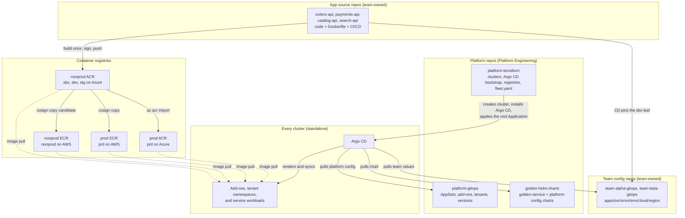
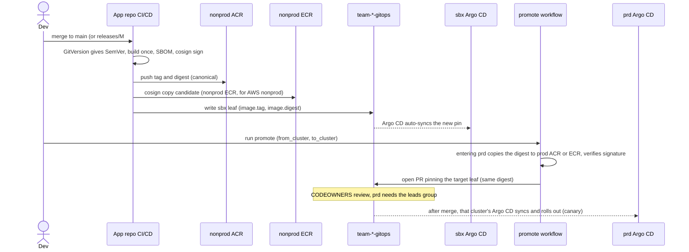

# Platform Guide

How this multi-cluster, multi-cloud GitOps platform fits together, and what you do to add a
service, a region, a cloud, a team or an environment. Written for someone seeing it for the first time.

**Contents**
1. [The platform in one minute](#1-the-platform-in-one-minute)
2. [The repositories and how they connect](#2-the-repositories-and-how-they-connect)
3. [How a cluster comes to life](#3-how-a-cluster-comes-to-life)
4. [Cluster identity: one Git repo, many different clusters](#4-cluster-identity-one-git-repo-many-different-clusters)
5. [Life of a change: from commit to running pod](#5-life-of-a-change-from-commit-to-running-pod)
6. [Onboarding recipes](#6-onboarding-recipes)
7. [Day-2 operations](#7-day-2-operations)
8. [Troubleshooting](#8-troubleshooting)
9. [Guardrails and validation](#9-guardrails-and-validation)
10. [Placeholders and known gaps](#10-placeholders-and-known-gaps)

See also [`../README.md`](../README.md) for the repo's design decisions, and the one-page lifecycle
diagram in the repo root: [`../argocd-lifecycle.excalidraw`](../argocd-lifecycle.excalidraw).

---

## 1. The platform in one minute

- Every Kubernetes cluster runs **its own standalone Argo CD**. There is no central hub, so a dev
  control plane can never reach prod, and adding an AWS cluster needs no cross-cloud credentials.
- **Git is the only source of truth.** After Terraform creates a cluster and installs Argo CD, nobody
  runs `kubectl apply`: Argo CD pulls the platform, the tenants and their workloads from Git.
- **One cluster = one environment + one cloud + one region.** Those three values are labels on the
  cluster. They decide which config a cluster renders, so the same Git repos serve every cluster.
- **Build once, promote many.** An app image is built one time, then the exact same digest moves
  through the environments. Each cluster has its own pin, so prod regions go one at a time.

### Glossary

| Term | Meaning |
| --- | --- |
| **Environment** | `sbx`, `dev`, `stg`, `prd`. Each is one or more separate clusters, never a namespace. |
| **Cloud / region** | `azure` or `aws` (`gke` is stubbed); region such as `centralus` (Azure) or `us-east-2` (AWS). |
| **Cluster** | The triple `<env>/<cloud>/<region>`, for example `sbx/azure/centralus`. Listed in `fleet.yaml`. |
| **Tenant** | A team (`team-alpha`, `team-beta`). It gets a namespace, quota, network policy, AppProject and its own config repo. |
| **Service** | One deployable app, for example `orders-api`. A tenant owns several. |
| **Golden chart** | `golden-service`, the one Helm chart every service uses (Rollouts, HPA, PDB, Gateway API route, secrets). |
| **Add-on** | Platform software installed on every cluster: External Secrets Operator (ESO), Istio (`istio-base` + `istiod`), Argo Rollouts. The shared Istio Gateway + SecretStore guard ship separately as the `platform-config` chart. |
| **ApplicationSet (AppSet)** | An Argo CD object that generates many Applications from a template and generators. |
| **Leaf** | `apps/<svc>/envs/<env>/<cloud>/<region>/values.yaml` in a team repo. It holds that cluster's image pin and is what switches a service on for that cluster. |
| **Ring** | A step in promotion: sbx, dev, stg, then each prd cluster in turn. |
| **Pin** | `image.tag` plus `image.digest`. The tag is human-readable; the digest is what is verified. |

---

## 2. The repositories and how they connect

In this folder each subdirectory stands for a **separate Git repository** in real life.

| Repo | Owner | What it is the source of truth for |
| --- | --- | --- |
| `platform-terraform` | Platform | Creating clusters, installing each cluster's Argo CD, registries, `fleet.yaml` (the list of all clusters and their pinned versions) |
| `platform-gitops` | Platform | Everything Argo CD reconciles after bootstrap: ApplicationSets, add-ons, AppProjects, tenant namespaces and quotas, per-cluster chart/add-on version pins |
| `golden-helm-charts` | Platform | The `golden-service` chart and the `platform-config` chart |
| `team-alpha-gitops`, `team-beta-gitops` | Each team | Which services the team runs, their values per env/cloud/region, the image pin per cluster, and the team's ESO SecretStore |
| `orders-api`, `payments-api`, `catalog-api`, `search-api` | Each team | Application **source**: code, Dockerfile, CI/CD. No Kubernetes manifests, no cloud/region folders |



> **Registry model is a pending decision.** The diagram and the CI/promotion workflows assume *shared*
> nonprod and prod registries (`nonprodacrplatform` / `prodacrplatform`, a geo-replicated prod ACR, a
> per-region prod ECR). Today **Terraform provisions a per-cluster ACR/ECR instead** (e.g.
> `acrplatsbxcus...`, `acrplatdevcus...`, an ECR in `us-east-2`). Reconcile the two before real use —
> see [§10](#10-placeholders-and-known-gaps).

### Where do I change X?

| I want to... | Change this | Repo |
| --- | --- | --- |
| Change app code or its Dockerfile | the source repo | `orders-api` etc. |
| Change replicas, host, env vars, secrets of a service | `apps/<svc>/...values.yaml` | `team-*-gitops` |
| Ship a new image version to a cluster | run `promote` (it edits the leaf) | `team-*-gitops` |
| Change what every service gets (probes, security context, labels) | the chart, then bump per-cluster pins | `golden-helm-charts`, `platform-gitops` |
| Upgrade ESO, Istio or Rollouts on a cluster | `envs/<env>/<cloud>/<region>/versions.yaml` | `platform-gitops` |
| Change a tenant's quota or network policy | `tenants/<team>/namespace/` | `platform-gitops` |
| Add a cluster | a new stack under `clusters/<cloud>/<env>/<region>` and a `fleet.yaml` entry | `platform-terraform` |

---

## 3. How a cluster comes to life

Two stages. Stage 1 is imperative and happens once per cluster; Stage 2 is declarative and never stops.

### Stage 1: bootstrap (Terraform, one apply per cluster)

Run from `platform-terraform/clusters/<cloud>/<env>/<region>/`. A single `terraform apply` provisions
everything (no `-target` passes):

1. Create the cluster (`modules/aks-cluster` or `modules/eks-cluster`) + its network + registry.
2. Install the **Gateway API CRDs** (`modules/gateway-api-crds`) — a foundational cluster capability,
   owned by Terraform like Argo CD itself and pinned by `gateway_api_version`.
3. Install Argo CD with Helm (`modules/argocd-bootstrap`, pinned by `argocd_chart_version`). Prod gets an HA install.
4. Create the **labeled `in-cluster` secret**: `environment`, `cloud`, `region`, `workloads=true`.
   This is how Argo CD learns which cluster it is.
5. Seed the **one** bootstrap secret, the GitHub App `repo-creds`, so Argo CD can read private repos.
6. Apply the **one** root Application, `platform-root`, pointing at `platform-gitops/bootstrap/app-of-apps`.

For a brand-new cluster whose GitHub App doesn't exist yet, apply once with `enable_argocd=false` to
stand up infra, create the App, then re-apply with `enable_argocd=true` and the creds set.

### Stage 2: steady state (Argo CD, forever)

```
platform-root                                   (Terraform applied; points at bootstrap/app-of-apps)
├── argocd-repositories  wave -15   registers the golden-charts OCI repository (argocd/repositories)
├── platform-projects    wave  -5   AppProjects: platform-addons, platform-tenants
└── platform-appsets     wave   0   every ApplicationSet in appsets/
    ├── platform-addons          (this cluster x its versions.yaml) x add-on list
    │     └── addon-<name>-in-cluster   istio-base (wave -6), ESO + istiod (-5), Argo Rollouts (-4)
    ├── platform-config          this cluster x versions.yaml -> platform-config chart
    │     └── platform-config-in-cluster   the shared Istio Gateway + the SecretStore admission guard
    ├── tenants-controlplane     per tenant: its AppProject + workload AppSet + config AppSet
    │     └── tenant-<team>-cp
    │           ├── AppProject <team>
    │           ├── ApplicationSet <team>-workloads
    │           │     └── <team>-<svc>-<env>-<region>   one Application per service leaf that exists for this cluster
    │           └── ApplicationSet <team>-config        syncs the team's SecretStore + eso-reader SA from its repo
    └── tenants-namespace        (this cluster x tenants/*)
          └── tenant-<team>-namespace   namespace, quota, network policy (namespace/)
```

Nothing in `platform-gitops` is cluster-specific. The same files are pulled by every cluster, and the
labels from step 4 steer each one to its own config.

The one non-Git input is the GitHub App key. Everything else that is secret (database passwords, API
keys) lives in the cloud vault (Key Vault or Secrets Manager). ESO reads it using **workload identity**
and creates Kubernetes Secrets from `ExternalSecret` objects in the golden chart. The `SecretStore`
itself is **team-owned**: each team authors it in its own repo under
`config/envs/<env>/<cloud>/<region>/`, and the `tenants-controlplane` config AppSet syncs it.

---

## 4. Cluster identity: one Git repo, many different clusters

A cluster's three labels pick the config at every layer:

| Layer | Path | Chosen by |
| --- | --- | --- |
| Add-on versions | `platform-gitops/envs/<env>/<cloud>/<region>/versions.yaml` | env + cloud + region |
| Add-on values | `platform-gitops/addons/<name>/base/values.yaml`, then `addons/<name>/envs/<env>/<cloud>/<region>/values.yaml` | base, then env + cloud + region |
| Tenant secret store | `<team>-gitops/config/envs/<env>/<cloud>/<region>/` (team-owned) | cloud + region |
| Service values | `team-*-gitops/apps/<svc>/base`, then `envs/<env>`, `envs/<env>/<cloud>`, `envs/<env>/<cloud>/<region>` (later wins) | env, then cloud, then region |
| Image pin + `goldenChart` version | the **leaf**, `envs/<env>/<cloud>/<region>/values.yaml` | exactly one cluster |

Put a setting at the **lowest layer where it is genuinely shared**. Replica counts are env-wide, the Azure
prod registry host is cloud-wide (one geo-replicated registry), an ECR host is regional so it lives in the leaf.

The ApplicationSet also passes `global.cloud`, `global.region` and `global.environment` to the chart, so
the chart can render cloud-specific bits (for example the Azure workload-identity label) without teams
hardcoding them.

### Worked example: `sbx/aws/us-east-2` resolving `orders-api`

```
labels                 environment=sbx  cloud=aws  region=us-east-2
versions.yaml          envs/sbx/aws/us-east-2/versions.yaml   ->  add-ons only (goldenChart is team-owned)
values, in order       base/values.yaml                       repo, route on, ESO secret, env vars
                       envs/sbx/values.yaml                    sizing (replicas, autoscaling)
                       envs/sbx/aws/values.yaml                (absent, skipped)
                       envs/sbx/aws/us-east-2/values.yaml      goldenChart pin, ECR repository, tag+digest pin, IRSA role-arn
chart parameters       global.cloud=aws  global.region=us-east-2  global.environment=sbx
secret store           <team>-gitops/config/envs/sbx/aws/us-east-2/  SecretStore "team-alpha-store" (Secrets Manager)
result                 407995386968.dkr.ecr.us-east-2.amazonaws.com/orders-api:0.1.0@sha256:...
```

The same service on `sbx/azure/centralus` skips the AWS files, takes the Azure ACR repository from its
own leaf, and gets the Azure workload-identity label from the chart.

### A service only runs where its leaf exists

The workload ApplicationSet discovers services with a git **files** generator on the leaf. So:
- a brand new cluster renders **no workloads** until services are promoted into it;
- prd regions are promoted independently (canary first), never all at once;
- the pin lives **only** in the leaf, never in `base`, env or cloud files.

---

## 5. Life of a change: from commit to running pod



- **Versioning:** a merge to `main` produces a prerelease (`0.4.0-alpha.3`) for sbx. A stable release comes
  from a `releases/M###` branch, is tagged `vX.Y.Z`, and the image is locked immutable.
- **Rings:** `sbx -> dev -> stg -> prd/azure/centralus (canary) -> prd/aws/us-east-2`.
  Each hop is one `promote` run and one reviewed PR that moves the same tag and digest. (Today only
  `sbx` and `dev` clusters exist; `stg`/`prd` are planned — see `fleet.yaml`.)
- **Registry action** depends only on the target (assuming the shared-registry model; see [§10](#10-placeholders-and-known-gaps)):

  | Promote to | What `promote` does with the image |
  | --- | --- |
  | sbx, dev, stg on Azure | nothing; same nonprod ACR digest |
  | dev, stg on AWS | nothing; CI already published the candidate to the nonprod ECR at build time |
  | `prd/azure/<region>` from stg | `az acr import` into the prod ACR (locked), verify signature |
  | `prd/azure/<region>` from another prd cluster | nothing; the prod ACR already has it |
  | `prd/aws/<region>` | `cosign copy` into that region's prod ECR, verify signature |

- **Progressive delivery:** the chart deploys an Argo Rollouts canary (25%, pause, 50%, pause).
- **Rollback:** revert that cluster's promotion PR. The previous digest is immutable and retained.

---

## 6. Onboarding recipes

Common to all of them: no `kubectl`, no edits to an ApplicationSet. You add files and open PRs.

### 6.1 Add a new service (existing team)

Example: `inventory-api` for team-alpha.

**1. Create the source repo** by copying an existing one (for example `orders-api`): `src/`, `Dockerfile`,
`GitVersion.yml`, `.github/workflows/ci.yml` and `cd.yml`.
- In `cd.yml` set `SERVICE: inventory-api` and `GITOPS_REPO: krupakar-hyland/team-alpha-gitops`. Leave `SBX_CLUSTER: sbx/azure/centralus`.
- Repo secrets: `AZURE_CLIENT_ID`, `AZURE_TENANT_ID`, `AZURE_SUBSCRIPTION_ID` (OIDC push to the nonprod ACR) and `GITOPS_PAT` (write to the team config repo).
- Keep the code cloud-agnostic: read endpoints and identities from environment variables.

**2. Create the secrets** the service needs in the team's vault (Key Vault on Azure, Secrets Manager on AWS) under the names you will reference.

**3. One PR to `team-alpha-gitops`:**

| File | Contents |
| --- | --- |
| `apps/inventory-api/base/values.yaml` | `image.repository` (the cluster's registry), `route.enabled`, `externalSecret` (`storeRef: team-alpha-store`, key mappings), `env` |
| `apps/inventory-api/envs/<env>/values.yaml` for `sbx dev stg prd` | sizing: `replicaCount`, `autoscaling` |
| `apps/inventory-api/envs/sbx/azure/centralus/values.yaml` | `goldenChart` (the chart version to run) and `route.host`. CI adds the image pin on its first run; the PR check allows an unpinned sbx leaf only |

Until the first CI build writes the pin, the sbx Application shows `image.tag or image.digest must be set`. That is expected.

**4. Merge the source repo to `main`.** CI builds, signs, pushes to the nonprod ACR and pins the sbx leaf. Argo CD on sbx deploys it.

**5. Promote through the rings** (Actions, **promote**, in `team-alpha-gitops`):

| Run | `from_cluster` | `to_cluster` |
| --- | --- | --- |
| 1 | `sbx/azure/centralus` | `dev/azure/centralus` |
| 2 | `dev/azure/centralus` | `stg/azure/centralus` |
| 3 | `stg/azure/centralus` | `prd/azure/centralus` |
| 4 | `prd/azure/centralus` | `prd/aws/us-east-2` |

The first promotion into a cluster **creates its leaf**. When the environment changes (runs 1 to 3) the
host is not copied, so edit the promotion PR to add that environment's `route.host`. For run 4 the host
is copied from the source leaf. The PR description says when a new leaf was created.
For AWS, add `serviceAccount.annotations` (`eks.amazonaws.com/role-arn`) to the leaf if the service calls AWS APIs.
(`stg` and `prd` clusters are planned, not yet in `fleet.yaml` — `promote` only pins leaves on clusters that exist.)

**6. Final touches:** DNS for the host (outside these repos), and optionally add the service to `platform-gitops/registry/tenants.yaml` (a human-readable index).

**You do not:** touch `platform-gitops`, edit any ApplicationSet, or run `kubectl`. If the service needs more
pods than the team quota allows, raise `tenants/<team>/namespace/resourcequota.yaml` in `platform-gitops`.

**Verify:**
```bash
python3 platform-gitops/tools/check_team_layout.py …        # layout, goldenChart policy and render check (also runs on every team-repo PR)
kubectl -n argocd get applicationsets                        # on the cluster
kubectl get applications -A -l service=inventory-api         # one per cluster where the leaf exists
```

### 6.2 Add a new region (existing cloud)

Example: a new Azure region. Same flow for a new AWS region with the AWS notes.

1. **Scaffold the cluster:** copy the nearest same-cloud stack to
   `platform-terraform/clusters/<cloud>/<env>/<region>/` and set its `terraform.tfvars` (identity + pins).
   Add a `platform-gitops/envs/<env>/<cloud>/<region>/versions.yaml` (start from a sibling cluster's pins).
2. **Add the entry to `fleet.yaml`.** CI's drift guard checks it against the stack and enforces monotonic promotion.
3. **Review `versions.yaml`.** Start from versions that have already soaked on a sibling cluster.
4. **Registry access:** depends on the registry-model decision ([§10](#10-placeholders-and-known-gaps)).
   With per-cluster registries the stack creates its own ACR/ECR; with shared registries, grant the new
   cluster's kubelet/node identity pull access on the shared registry.
5. **Add-on identity:** add `platform-gitops/addons/external-secrets/envs/<env>/<cloud>/<region>/values.yaml`
   with the ESO workload-identity client ID (Azure) or role ARN (AWS). If it is missing, ESO cannot authenticate.
6. **Apply Terraform** in the new stack (one apply). It creates the cluster, installs the Gateway API CRDs and Argo CD,
   labels the cluster, seeds the repo secret and applies the root app. Within minutes the add-ons and every
   tenant's namespace appear. **No workloads yet**, because no leaves exist.
7. **Promote each service in**, for example from `prd/azure/centralus` to the new region. The leaf is created and the host is copied.
8. **Traffic:** add the new region to your global routing (Front Door, Traffic Manager, Route 53). This is outside these repos.

**Verify:** `kubectl -n argocd get applications` on the new cluster shows the add-ons `Healthy`, then the services after step 7.

### 6.3 Add a new cloud

Everything in 6.2, plus the parts that are cloud-specific:

1. **Cluster module:** replace the placeholder `modules/<cloud>-cluster` with a real one. It must output what the providers need, and a node or kubelet identity for registry pulls.
2. **Registry for that cloud:** per the registry model, and extend the `case "$TO_CLOUD"` block in each team's `promote.yml`
   (today only `azure` and `aws` are handled, anything else fails fast) with the copy and login steps.
3. **Tenant secret store:** each team adds `config/envs/<env>/<cloud>/<region>/` (SecretStore + `eso-reader` SA) in its own repo for the new cloud. Without it, the team's config AppSet has nothing to sync on that cluster.
4. **Chart:** if the cloud needs a workload-identity **label** on pods, add a branch in `golden-service` identity labels. (AWS and GKE only need annotations, which come from team overlays.)
5. **Add-on identity** overlays for ESO and any other add-on that talks to the cloud.
6. **Team overlays (optional):** `apps/<svc>/envs/<env>/<cloud>/values.yaml` for the registry host, then leaves via `promote`.

### 6.4 Add a new team (tenant)

1. **Scaffold:** `platform-gitops/tools/onboard-tenant.sh team-gamma`. This copies `platform-gitops/tenants/_template`, substitutes the name, and registers the team in `registry/tenants.yaml`.
2. **Fill in** `namespace/resourcequota.yaml` and the group in `controlplane/project.yaml`. (The ESO SecretStore is authored later in the team's own repo under `config/envs/<env>/<cloud>/<region>/`.)
3. **Confirm** the team is in `platform-gitops/registry/tenants.yaml`.
4. **Create `krupakar-hyland/team-gamma-gitops`** with the same layout as `team-alpha-gitops`: `apps/`, `config/`, `CODEOWNERS`, `.github/workflows/` (its `validate.yml` calls the reusable platform check, plus `promote.yml`).
   Set the promote secrets: `AZURE_PROMOTE_CLIENT_ID`, `AZURE_TENANT_ID`, `AZURE_SUBSCRIPTION_ID`, `AWS_PROMOTE_ROLE_ARN`.
5. **Vault and identity:** create the team's vault and grant ESO's workload identity read access, per cloud.
6. **Merge the `platform-gitops` PR.** On every cluster the AppSets create the AppProject, namespace, quota, NetworkPolicy and the team's workload + config ApplicationSets. No change to any global file (`argocd-rbac-cm`) is needed.
7. Make sure the GitHub App installation can read the new repo.

### 6.5 Add a new environment (for example `uat`)

The current environments are `sbx`, `dev`, `stg` and `prd`.

1. Add its cluster(s): copy the nearest same-cloud stack under `platform-terraform/clusters/<cloud>/uat/<region>/`. The `environment` label is free-form.
2. Review the seeded `platform-gitops/envs/uat/<cloud>/<region>/versions.yaml`.
3. Registry: grant the cluster's identity pull access per the registry model.
4. Update the places that hardcode the env order: the `re=` pattern and `rank()` in each team's `promote.yml`, and `ENV_ORDER` in `platform-terraform/scripts/validate_fleet.py`.
5. Teams add optional `envs/uat/values.yaml`, then promote into `uat/<cloud>/<region>`.

---

## 7. Day-2 operations

| Task | How |
| --- | --- |
| Upgrade the golden chart | Platform: add a `CHANGELOG.md` entry, bump `Chart.yaml` and `support-policy.yaml` (`latest`), tag `golden-service-vX.Y.Z`; the publish job refuses to overwrite a version. Each team then bumps `goldenChart` in its own cluster leaves (`apps/<svc>/envs/<env>/<cloud>/<region>/values.yaml`), sbx first, soaking, then ring by ring, at its own pace. The team-repo PR check blocks a ring that is ahead of the one below it. |
| Retire an old chart version | Raise `minimumSupported` in `support-policy.yaml` (or list it under `deprecated` first to get warnings). Teams still on it fail their PR check until they upgrade. |
| Upgrade an add-on | `envs/<env>/<cloud>/<region>/versions.yaml`, the `addons:` map. One cluster at a time. |
| Upgrade a Terraform module or the Argo CD chart | Bump the `?ref` / pin in the sbx stack, `apply`, soak, promote up. Keep `fleet.yaml` in step; CI's drift guard enforces it. |
| Roll an app back | Revert that cluster's promotion PR. Argo CD re-syncs to the previous digest. |
| Rotate an app secret | Change it in the vault. ESO refreshes the Kubernetes Secret on its refresh interval. |
| Recover a lost cluster | Re-run its Terraform stack. The root app rebuilds the whole platform and all workloads from Git. |
| See what a cluster is running | `kubectl get applications -A` on that cluster, or its Argo CD UI. Applications carry `tenant`, `service` and `environment` labels. |

Team developers can **view and sync** their own apps through their AppProject role. They cannot create
namespaces, quotas or network policies; the platform owns those.

---

## 8. Troubleshooting

| Symptom | Likely cause | Fix |
| --- | --- | --- |
| A service does not appear on a cluster | No leaf for that cluster, or a typo in the path | Check `apps/<svc>/envs/<env>/<cloud>/<region>/values.yaml` exists; run `check_team_layout.py` (it catches region typos against `fleet.yaml`; it also runs on every team-repo PR) |
| `image.tag or image.digest must be set` | Leaf exists but has no pin (new service, before the first CI build) | Wait for the first build, or run `promote` |
| `image.repository is required` | `base/values.yaml` has no repository | Add it |
| Add-ons and workloads render **nothing** on a new cluster | Missing `envs/<env>/<cloud>/<region>/versions.yaml` | Create it (start from a sibling cluster's pins) |
| `tenant-<team>-config` syncs nothing / SecretStore missing | The team has no `config/envs/<env>/<cloud>/<region>/` for this cluster | Add the SecretStore + `eso-reader` SA in the team repo |
| `ImagePullBackOff` | Cluster identity lacks pull on the registry, or the digest was never copied to the target registry | Grant pull on the cluster's registry; re-run `promote` into that leaf |
| ExternalSecret `SecretSyncedError` | Secret name missing in the vault, or ESO identity not set for this region | Check `remoteKey`; add the ESO identity overlay for this env/cloud/region |
| Route has no host | The leaf was created by `promote` across environments, which does not copy the host | Add `route.host` to the leaf |
| Not reachable over the gateway LB IP | External ingress not wired to the Istio `platform-gateway` LB (or an LB/NSG/dataplane issue) | Confirm the `HTTPRoute` host and that the gateway LB forwards to the correct nodePort |
| `promote`: "cannot promote backwards", "source leaf not found" | Wrong `from_cluster`/`to_cluster` | Use `<env>/<cloud>/<region>`, a forward direction, and a source that exists |
| `promote`: "cannot skip rings" / "enter prd through the canary" | One ring at a time, and prd is entered through `prd/azure/centralus` first | Promote the next ring, or for a real emergency set `skip_justification` (recorded in the PR) |
| `promote`: "only stable releases ... can enter stg" | The source pin is a prerelease (`-alpha`) | Cut a `releases/M###` branch so a stable build exists; stg tests the digest that prd will get |
| `promote`: cosign verify fails on identity | The digest was not signed by this service's `cd.yml` on a `releases/M###` branch | Re-release from a release branch; do not loosen the identity |
| An Application errors with `MISSING-goldenChart-in-leaf` | The leaf has no (or an empty) `goldenChart` | Add it; the team-repo PR check normally blocks this before merge |
| Team-repo PR check fails on `goldenChart` | Below `minimumSupported`, ahead of `latest`, not SemVer, or ahead of the lower ring | See `golden-helm-charts/support-policy.yaml`; upgrade sbx first, then dev, stg, prd |

---

## 9. Guardrails and validation

- **Isolation:** one Argo CD per cluster, a dedicated AppProject per tenant (allowed repos, namespace, resource kinds), tenants cannot create cluster-scoped resources, quotas or network policies.
- **Immutability:** the SemVer tag is locked in the registry and the pod pulls by digest. Published chart versions are immutable too (the publish job refuses to overwrite one).
- **Provenance:** entering stg or prd, `promote` verifies the digest was cosign-signed by **that service's own `cd.yml` running on a `releases/M###` branch**, and only stable `X.Y.Z` can enter stg/prd, so the digest tested in stg is the one that ships.
- **Promotion guardrails:** one ring at a time (an audited `skip_justification` for emergencies), prd entered through the canary cluster first, concurrent promotions of the same target serialised.
- **PR validation:** every repo that drives production has a PR check. Team repos call the platform's reusable `validate-team-repo` workflow; `platform-gitops` validates itself (`tools/validate_platform.py` + kubeconform); the chart repo runs lint, render scenarios and a policy/CHANGELOG check. Make these required checks in branch protection.
- **Pre-merge scanning:** gitleaks, `govulncheck` and Trivy run in CI. Currently only in `orders-api`.
- **Review gates:** `CODEOWNERS` in every repo: team repos (`apps/*/envs/prd/` also needs the team leads) and the platform repos (`platform-gitops`, `golden-helm-charts`, `platform-terraform`). Every promotion is a PR.
- **Prod registry isolation:** CI has no access to the prod registries; only the promotion identity can import or copy.
- **Checks you can run locally:**
  ```bash
  python3 platform-gitops/tools/check_team_layout.py …  # every leaf maps to fleet.yaml, pin only in the leaf, goldenChart inside the
                                                         # support policy and ring order, chart renders, image host matches the cloud
  python3 platform-gitops/tools/validate_platform.py --fleet platform-terraform/fleet.yaml
                                                         # fleet <-> versions files, tenant layout, template drift, chart source
  golden-helm-charts/tests/render_scenarios.sh           # HPA / PDB / Gateway API route / identity / image regression scenarios
  python3 platform-terraform/scripts/validate_fleet.py   # fleet.yaml vs stacks (needs PyYAML)
  terraform fmt -check -recursive platform-terraform
  ```

---

## 10. Placeholders and known gaps

This is a reference implementation. Before real use:

- **Registry model is undecided.** The CI/promotion workflows assume *shared* registries
  (`nonprodacrplatform`, `prodacrplatform`, a geo-replicated prod ACR, a per-region prod ECR) and a
  single shared nonprod digest. Terraform currently provisions a **per-cluster ACR/ECR** instead
  (e.g. `acrplatsbxcus...`, an ECR in `us-east-2`). Pick one model and align the workflows, the
  `check_team_layout.py` prd registry guard, and `base/values.yaml` (which should not hardcode a
  per-cluster registry).
- The GitHub organisation is `krupakar-hyland` throughout. Still to replace with real values: registry names, the state buckets, and every `REPLACE_*` value (ESO client IDs, AWS account IDs, role ARNs).
- `modules/aks-cluster`, `eks-cluster` and `gke-cluster` are placeholders for your real cluster modules.
- Cluster inventory lives only in `platform-terraform/fleet.yaml` (CI-validated). `platform-gitops/registry/tenants.yaml` is a light team→repo index; the tenant isolation source of truth is the `tenants/<team>/` folders.
- Tenant secret stores use one vault per team (not per environment or region); the AWS store pins `us-east-2`.
- `validate_fleet.py` needs PyYAML installed.
- The CI security scans (gitleaks, `govulncheck`, Trivy) exist only in `orders-api`; the other app repos still run vet + build. They are also not required checks, and `cd.yml` does not wait for `ci.yml`.
- Signature verification happens in `promote` only; clusters do not verify at admission (no Kyverno/policy-controller). `az acr import` does not copy cosign signatures, so prod ACR images carry none; provenance is proven at the nonprod registry instead.
- North-south TLS is terminated at an external L7 load balancer; the Istio Gateway listener is plain HTTP, and there is no in-cluster cert-manager. The external front door (App Gateway / Front Door) that terminates TLS and forwards to the gateway is not part of these repos.
- Open from the platform review (not addressed yet): no compatibility matrix or automated updates for add-on pins; no Argo Rollouts analysis, observability or Argo CD notifications; tenants cannot open NetworkPolicy egress; Argo CD `policy.default: role:readonly`; `platform-gitops@main` is pulled by every cluster at once; S3 Terraform backends have no state locking; CI pushes the sbx pin with a static `GITOPS_PAT`.
- Global traffic management (one public hostname across regions) is not part of these repos.
- The ApplicationSets (nested matrix plus git files generator) were validated by rendering. Do the first dry run on the sbx cluster.
